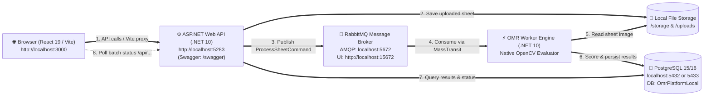

# 💻 Local Development Guide: OMR SaaS Platform

Welcome to the **Local Development Guide** for the Enterprise OMR Platform. This guide walks developers through setting up, running, and debugging the entire OMR platform (Frontend, Backend Web API, Worker Engine, RabbitMQ, and PostgreSQL) on a local machine (Linux, macOS, or Windows).

---

## 🏗️ 1. Local System Architecture & Topology

The platform uses an asynchronous microservice and message-driven architecture to guarantee high throughput when processing and grading scanned OMR sheets:



| Component | Technology | Local Port | Access URL |
| :--- | :--- | :--- | :--- |
| **Frontend Web** | React 19, Vite, Tailwind CSS | `3000` | [http://localhost:3000](http://localhost:3000) |
| **Backend API** | ASP.NET Core (.NET 10) | `5283` | [http://localhost:5283/swagger](http://localhost:5283/swagger) |
| **OMR Worker** | .NET 10 Worker, OpenCV / Native Engine | Background | Worker Console Logs |
| **Message Broker** | RabbitMQ 3.13 (MassTransit) | `5672` (AMQP), `15672` (UI) | [http://localhost:15672](http://localhost:15672) |
| **Database** | PostgreSQL 15/16 | `5432` or `5433` | Host connection |
| **Database UI** | pgAdmin 4 | `5050` | [http://localhost:5050](http://localhost:5050) |

---

## 📋 2. Prerequisites

Ensure you have the following installed on your development machine:

1. **[.NET 10 SDK](https://dotnet.microsoft.com/download/dotnet/10.0)** (or latest .NET LTS SDK supported by solution).
   Verify in terminal:
   ```bash
   dotnet --version
   ```
2. **[Node.js 20+ LTS](https://nodejs.org/)** and `npm`.
   Verify in terminal:
   ```bash
   node -v
   npm -v
   ```
3. **[Docker Desktop](https://www.docker.com/products/docker-desktop/)** (or Docker Engine + Docker Compose on Linux).
   Used to spin up PostgreSQL and RabbitMQ backing containers with zero local install hassle.
   Verify in terminal:
   ```bash
   docker compose version
   ```
4. **Git** and your preferred IDE (VS Code with C# Dev Kit, Visual Studio 2022/2026, or JetBrains Rider).

---

## 🚀 3. Quick-Start (Hybrid Mode — Recommended)

The **Hybrid Mode** runs databases and RabbitMQ in Docker, while running the API, Worker, and Web frontend directly on your host machine for instant live-reload, debugging, and IDE breakpoints.

### Step 1: Start Backing Services (Database & RabbitMQ)

In your terminal, navigate to the `omr-api` directory and start only the backing services:

```bash
cd /var/www/vps-infra/src/omr-api
# or your local clone: cd path/to/omr-api

# Spin up Postgres, RabbitMQ, and pgAdmin in Docker
docker compose -f docker-compose.local.yml up -d db rabbitmq pgadmin
```

Verify backing containers are running:
```bash
docker compose -f docker-compose.local.yml ps
```
- **RabbitMQ Dashboard**: Open [http://localhost:15672](http://localhost:15672) (User: `guest`, Password: `guest`).
- **Postgres Database**: Running on `localhost:5433` (or `5432`) with Database: `OmrPlatformLocal`, User: `postgres`, Password: `LocalPostgres@123`.

---

### Step 2: Run the Backend API

The API automatically applies Entity Framework Core database migrations and seeds initial master data (roles, permissions, SuperAdmin user) on first run:

```bash
cd /var/www/vps-infra/src/omr-api
# or: cd path/to/omr-api

# Restore dependencies
dotnet restore OmrPlatform.sln

# Launch API using the "Local" launch profile (listens on http://localhost:5283)
dotnet run --project OmrPlatform.Api.csproj --launch-profile Local
```

Once running:
- **API URL**: [http://localhost:5283](http://localhost:5283)
- **Interactive Swagger UI**: [http://localhost:5283/swagger](http://localhost:5283/swagger)
- **Health Check**: [http://localhost:5283/health](http://localhost:5283/health)

---

### Step 3: Run the OMR Background Worker

Open a new terminal window to run the worker process responsible for consuming RabbitMQ queues and scoring sheets:

```bash
cd /var/www/vps-infra/src/omr-api
# or: cd path/to/omr-api

# Launch the OMR Worker engine
dotnet run --project OmrPlatform.Worker/OmrPlatform.Worker.csproj
```

You should see logs indicating:
```text
info: MassTransit[0]
      Endpoint Ready: rabbitmq://localhost/omr-sheet-queue
      Endpoint Ready: rabbitmq://localhost/omr-batch-queue
info: Microsoft.Hosting.Lifetime[0]
      Application started. Hosting environment: Development
```

---

### Step 4: Run the Web Frontend

Open another terminal window to launch the React 19 / Vite development server:

```bash
cd /var/www/vps-infra/src/omr-web
# or: cd path/to/omr-web

# Install frontend dependencies
npm install --legacy-peer-deps

# Start Vite dev server
npm run dev
```

Once started:
- Open your browser at **[http://localhost:3000](http://localhost:3000)**.
- Vite automatically proxies all requests starting with `/api` and `/uploads` to `http://localhost:5283`.

---

## 🔑 4. Default Seed Credentials & Access Table

The database seeder automatically initializes the following default account on startup:

| Field | Default Value | Notes |
| :--- | :--- | :--- |
| **SuperAdmin Email** | `superadmin@domain.com` | Configured in `appsettings.json` (`SeedData:SuperAdmin`) |
| **SuperAdmin Password** | `SuperAdmin@123` | Default seed password |
| **RabbitMQ Management** | `guest` / `guest` | [http://localhost:15672](http://localhost:15672) |
| **pgAdmin 4** | `admin@domain.com` / `admin` | [http://localhost:5050](http://localhost:5050) |

---

## 🐳 5. Option B: Full Docker-Compose Workflow

If you prefer running all services inside Docker containers without installing .NET or Node locally:

```bash
cd /var/www/vps-infra/src/omr-api

# Build and start all 5 containers (DB, RabbitMQ, pgAdmin, API, Worker)
docker compose -f docker-compose.local.yml up --build -d
```

To run the web app in Docker as well:
```bash
cd /var/www/vps-infra/src/omr-web
docker compose -f docker-compose.local.yml up --build -d
```
Access points in full Docker mode:
- Web App: `http://localhost:3005`
- API: `http://localhost:8085`

---

## 🧪 6. Testing OMR Processing End-to-End

To verify your local setup end-to-end:

1. **Login**: Go to [http://localhost:3000](http://localhost:3000) and login with `superadmin@domain.com` / `SuperAdmin@123`.
2. **Navigate to Examinations**:
   - Go to **Examinations** → **Tests** → Select or create a test.
3. **Upload an OMR Sheet**:
   - Click **Bulk Upload / Mobile OMR Scan**.
   - Use test sample fixture sheets located at:
     ```text
     src/omr-api/tests/data/OMR/100Q/Scan_0025.jpg
     ```
4. **Observe the Pipeline**:
   - **API Terminal**: Receives upload, stores image, and dispatches message to `omr-sheet-queue`.
   - **RabbitMQ UI ([http://localhost:15672](http://localhost:15672))**: You will see message queue activity spike and clear instantly.
   - **Worker Terminal**: Logs OpenCV sheet alignment, bubble extraction, and grading:
     ```text
     [NativeOmrResultService] Native Sheet Scan_0025.jpg persisted and committed atomically.
     Status: Processed, Marks: 24.00
     [ProcessSheetConsumer] Successfully committed results for Sheet ...
     ```
   - **Browser UI**: Polling detects the `completed` status and shows student marks, score breakdown matrix, and scanned sheet overlay!

---

## 🛠️ 7. Running Unit & Integration Tests

### Backend Unit & Integration Tests (.NET)
```bash
cd /var/www/vps-infra/src/omr-api

# Run all unit tests
dotnet test tests/SchoolErp.UnitTests/OmrPlatform.UnitTests.csproj

# Run all integration tests (requires local test DB)
dotnet test tests/SchoolErp.IntegrationTests/OmrPlatform.IntegrationTests.csproj
```

### Frontend Tests (Vitest & Playwright)
```bash
cd /var/www/vps-infra/src/omr-web

# Run Vitest unit tests
npm run test

# Run tests with code coverage report
npm run test:coverage
```

---

## ❓ 8. Common Troubleshooting & FAQs

### Q1: `404 (Not Found)` on Batch Polling in Web UI
- **Cause**: The frontend `.env` is pointing to an external domain or missing the `/api` prefix.
- **Fix**: For local development, ensure `.env.development` has:
  ```env
  VITE_API_BASE_URL=/api
  ```
  Vite will proxy `/api` calls directly to `http://localhost:5283`.

### Q2: Port Conflict on `5432` (PostgreSQL)
- **Cause**: You already have a local PostgreSQL instance running on your host machine.
- **Fix**: In `docker-compose.local.yml`, Postgres is mapped to port `5433:5432`. Ensure your `appsettings.Local.json` connection string uses `Port=5433` if connecting to the Docker container:
  ```json
  "DefaultConnection": "Host=localhost;Port=5433;Database=OmrPlatformLocal;Username=postgres;Password=LocalPostgres@123;"
  ```

### Q3: RabbitMQ Connection Refused (`5672`)
- **Cause**: RabbitMQ container is not running or healthcheck has not passed yet.
- **Fix**: Run `docker compose -f docker-compose.local.yml ps` to confirm `school_erp_rabbitmq_local` is healthy. Test connection with `telnet localhost 5672` or visit [http://localhost:15672](http://localhost:15672).

### Q4: Uploaded images not displaying in UI
- **Cause**: Static uploads directory not resolved.
- **Fix**: Ensure the directory `./wwwroot/uploads` exists in `src/omr-api`. The Vite dev server will proxy `/uploads` to `http://localhost:5283/uploads`.

---

*Need help or encountered an issue? Reach out to the TMK DevOps team or open an issue on the repository.*
