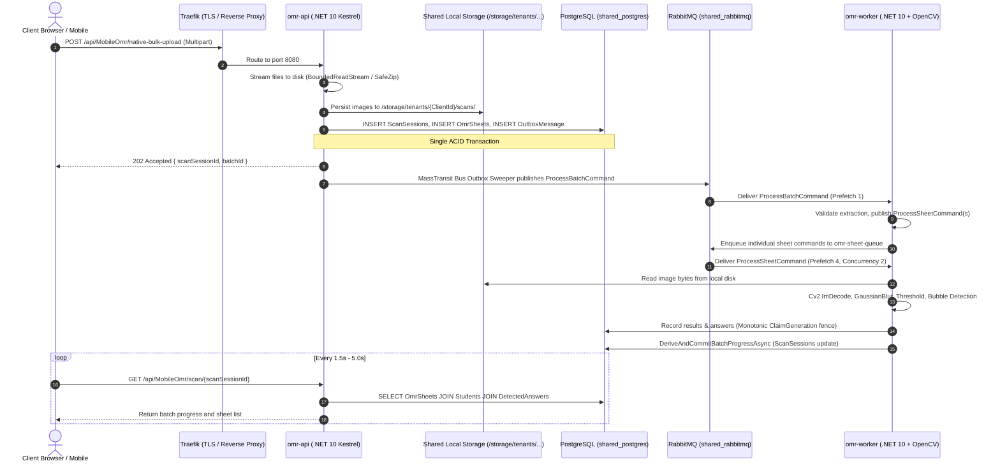
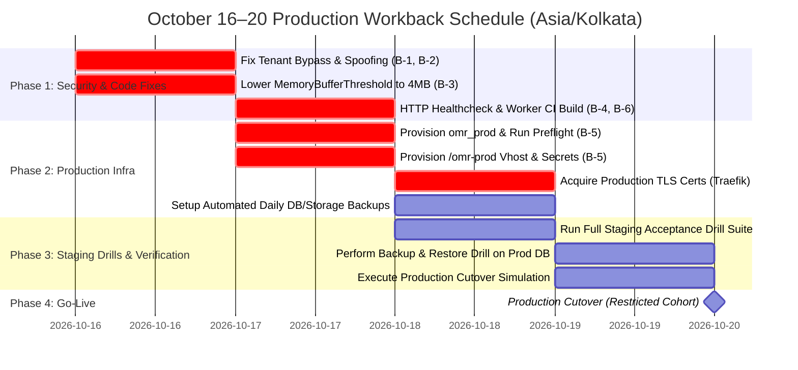

# Evidence-Based Architecture & Go-Live Feasibility Audit
**Target Launch Date:** October 20, 2026 (Asia/Kolkata)  
**Audit Date:** October 16, 2026 (Asia/Kolkata)  
**Host Hardware Target:** Single VPS (8 vCPU, 32 GB RAM, ~387 GB NVMe/SSD)  
**System Under Audit:** OMR Enterprise SaaS Platform (`vps-infra`, `omr-api`, `omr-worker`, `omr-web`)  
**Audit Type:** Read-Only Architecture, Capacity, Platform-Fit, and Release-Readiness Feasibility Audit  

---

## 1. Executive Summary & Verdict

### 1.1 Feasibility Verdict

| Evaluation Category | Assessment Status | Summary Verdict |
| :--- | :--- | :--- |
| **October 20 Launch (Restricted Pilot Cohort)** | **CONDITIONAL GO** | Feasible **ONLY** if the 6 Launch Blockers (Tenant Bypass, Memory Buffer Sizing, Worker CI Build, TLS/Secrets, HTTP Healthchecks) are remediated, backend-enforced, and verified in staging by October 19, 18:00 IST. |
| **October 20 Launch (Unrestricted / As-Is Revision)** | **NO-GO** | Current deployed revision `6c693c9` on `omr-api` contains confirmed tenant filter bypass weaknesses on null/empty claims, lacks upload admission bounds, and lacks provisioned production infrastructure (`omr_prod`, `/omr-prod`, trusted TLS). |
| **500+ Institutes Long-Term Target on Single VPS** | **NOT VERIFIED / CAPACITY CONTINGENT** | Capacity for 500+ registered institutes has not been empirically benchmarked on this single host. Sustaining this workload depends on the ratio of concurrent active users, batch submission scheduling, and background grading distribution. Without backend-enforced admission quotas and empirical multi-tenant load verification, high-concurrency 500+ tenant operation cannot be guaranteed on a single VPS. |

### 1.2 Verdict Breakdown & Decision Rule

1. **CONDITIONAL GO (Provisional Pilot Envelope Requiring Enforcement):**
   - **Provisional Operational Policy:** Initial pilot onboarding should be conservatively phased (e.g., pilot institutes with staggered schedules), pending backend quota enforcement.
   - **Upload Ingress:** Enforce bounded concurrent upload slots (e.g. max 2-3 simultaneous uploads host-wide) via backend semaphores.
   - **Batch Sizing:** Provisional batch ceiling of 50–100 sheets per submission, enforced at API level.
   - **Image Constraints:** Bounded file size (max 10 MB per image) and pre-decoding dimension validation.
   - **Worker Concurrency:** Concurrency 2 parallel sheets (`SheetGradingConcurrency=2`, `PrefetchCount=4`), supported by empirical measurements.
   - **Required Remediation & Gate Delivery:** October 19, 2026, 18:00 IST.
2. **Instant NO-GO Conditions:**
   - Any unresolved tenant-isolation defect or failure to fail-closed on October 19 is an immediate NO-GO.
   - Pilot limits are provisional operational recommendations and do not protect the platform until backend enforcement is implemented, tested, and active.

---

## 2. Actual Host & Deployed Revision Baseline

### 2.1 Hardware Specifications & Current Host Utilization

Physical host inspection conducted via read-only system telemetry on October 16, 2026:

```
Metric              Allocated / Total       Current Used            Available / Free        % Utilization
---------------------------------------------------------------------------------------------------------
vCPU Cores          8 vCPUs (x86_64)        ~0.25 cores (idle)      7.75 cores              ~3.1% (idle)
System Memory       31.34 GiB (32 GB)       3.30 GiB                28.04 GiB (avail)       10.5%
Swap Space          0 B                     0 B                     0 B                     N/A (Disabled)
Storage (/dev/sda1) 387.0 GB                30.0 GB                 357.0 GB                7.8%
Inodes (/dev/sda1)  52,297,728              429,944                 51,867,784              0.82%
```

> [!WARNING]
> **Swap Space Disabled (0 B):** Because Linux swap is completely disabled on this host, any burst in memory allocation that crosses the Docker container limit or host RAM limit will trigger an immediate, unbuffered Linux kernel OOM (Out Of Memory) killer kill event rather than paging to disk.

### 2.2 Host Workloads & Multi-Tenant Container Inventory

The single VPS currently hosts infrastructure services, customer QA containers, CI/CD runners, and production platform containers:

| Container Name | Running Image & Tag | Status | Memory Limit | Current Mem | CPU Quota | Net I/O | Block I/O | Role / Classification |
| :--- | :--- | :--- | :--- | :--- | :--- | :--- | :--- | :--- |
| `omr-worker-qa` | `localhost:5000/omr-worker:qa` | Up 3h (healthy) | 2,048 MiB | 121.5 MiB | **0 (None)** | 1.66MB / 1.66MB | 4.1kB / 16.4kB | Customer OMR QA Worker |
| `omr-api-qa` | `localhost:5000/omr-api:qa` | Up 12h (healthy) | 1,536 MiB | 244.5 MiB | **0 (None)** | 9.77MB / 6.38MB | 20.5kB / 6.31MB | Customer OMR QA API |
| `omr-web-qa` | `localhost:5000/omr-web:qa` | Up 12h | **None (31 GiB)** | 7.53 MiB | **0 (None)** | 8.66kB / 12.2kB | 32.8kB / 12.3kB | Customer OMR QA Frontend |
| `shared_rabbitmq` | `rabbitmq:3.13-management-alpine` | Up 13h (healthy) | 2,048 MiB | 143.5 MiB | **0 (None)** | 556kB / 518kB | 20.5kB / 1.07MB | Platform Shared Messaging |
| `shared_postgres` | `postgres:16-alpine` | Up 30h (healthy) | 1,024 MiB | 80.6 MiB | **0 (None)** | 141MB / 388MB | 438kB / 203MB | Platform Shared PostgreSQL |
| `traefik_global` | `traefik:latest` | Up 30h | 256 MiB | 22.3 MiB | **0 (None)** | 84MB / 88.7MB | 36.9kB / 0B | Platform Reverse Proxy / TLS |
| `devops-api-prod` | `ghcr.io/tmk-computers/tmk-devops-api:latest` | Up 14h (healthy) | 512 MiB | 208.2 MiB | **0 (None)** | 9.58MB / 8.39MB | 713kB / 9.97MB | Platform DevOps API (Prod) |
| `devops-web-prod` | `ghcr.io/tmk-computers/tmk-devops-web:latest` | Up 14h | **None (31 GiB)** | 7.62 MiB | **0 (None)** | 20.3kB / 1.2MB | 0B / 8.19kB | Platform DevOps UI (Prod) |
| `ci-api-prod` | `ghcr.io/tmk-computers/tmk-ci-api:latest` | Up 14h | **None (31 GiB)** | 47.57 MiB | **0 (None)** | 204MB / 11.6MB | 98.3kB / 4.1kB | Platform CI Runner API (Prod) |
| `ci-web-prod` | `ghcr.io/tmk-computers/tmk-ci-web:latest` | Up 14h | **None (31 GiB)** | 7.45 MiB | **0 (None)** | 6.48kB / 126B | 0B / 12.3kB | Platform CI Runner UI (Prod) |
| `docker-registry-backend` | `registry:2` | Up 30h | **None (31 GiB)** | 49.76 MiB | **0 (None)** | 1.58GB / 411MB | 6.62MB / 1.58GB | Local Private Registry |
| `docker-registry-ui` | `joxit/docker-registry-ui:latest` | Up 30h | **None (31 GiB)** | 7.81 MiB | **0 (None)** | 248kB / 767kB | 0B / 139kB | Local Registry UI |
| `pgadmin` | `dpage/pgadmin4:latest` | Up 23h | 256 MiB | **231.2 MiB (90.3%)** | **0 (None)** | 3.32MB / 8.46MB | 737kB / 12.5MB | Database Web Administration |

#### Critical Utilization & Exposure Observations:
1. **Zero CPU Quotas Across All Containers:** Every container has `CpuQuota: 0` (`NanoCPUs: 0`). When CI builds run or OpenCV extraction bursts, processes compete for all 8 vCPUs without fair CPU scheduling.
2. **Unbounded Memory Limits on CI API and Web Frontends:** `ci-api-prod`, `ci-web-prod`, `devops-web-prod`, `docker-registry-backend`, and `omr-web-qa` have no memory limits (`Memory: 0`). A runaway CI build or compilation thread can allocate host memory unrestricted.
3. **pgAdmin Memory Pressure (90.3%):** `pgadmin` is consuming 231.2 MiB out of its 256 MiB limit (90.32% memory saturation).
4. **Dangerous Host Port Bindings:** PostgreSQL port `5432` and pgAdmin port `5050` are bound to `0.0.0.0` on the public host interface, rather than `127.0.0.1` or internal Docker networks.

### 2.3 Repository Baseline & Revision Drift Analysis

Inspection of local git repositories against running Docker image digests revealed significant revision drift between API and Worker:

```
Repository                  Tracked Branch                  Head Commit ID  Commit Timestamp (UTC)          Working Tree
------------------------------------------------------------------------------------------------------------------------
/var/www/vps-infra          main                            1704bf1dc01d    2026-10-15 08:55:41 +0000       Clean
/var/www/vps-infra-server   main                            b637df795591    2026-10-15 05:20:27 +0000       Clean
/var/www/vps-infra/code/omr-api  feat/async-omr-durable-storage 6d1aa19fb15f    2026-10-15 18:18:01 +0000       Clean
/var/www/vps-infra/code/omr-web  feat/async-omr-frontend-controls 744962c0ad6a  2026-10-14 16:58:04 +0000       Clean
```

#### Running Image Digest vs Code Inspection:

1. **`omr-api-qa` Image Digest:** `sha256:8499d7179e7acd55c322d2636cc8e451ce83033f15b5982a6c7b5bf7153ce165`
   - **Tag:** `qa-20261015-6c693c9` (Built 2026-10-15T06:43:40Z).
   - **Source Commit:** `6c693c9` — **6 commits behind HEAD (`6d1aa19`)**.
   - **Missing Fixes in Running API:**
     - Missing `fb54ae9` (*fix(results): clear existing detected answers before adding on sheet retry to prevent duplicate key constraint violation*).
     - Missing `c9c3d2d` (*fix(worker,scripts): resolve worker ASP.NET runtime dependency, PL/pgSQL percent escaping*).
     - Missing `932d479`, `f1fdbd8`, `6d1aa19` (*worker readiness sentinel tightening*).
2. **`omr-worker-qa` Image Digest:** `sha256:14cd7fb483720264619083a5b017b12338bf77ed4abf792ce7cb6f821956b412`
   - **Built:** 2026-10-15T16:17:42Z (Rebuilt independently, contains commits through `f1fdbd8`/`6d1aa19`).
3. **`omr-web-qa` Image Digest:** `sha256:75d8ebeba6c9bb81d555c333612c713b8701e1d16d87a68874aaf5ff9a207f23`
   - **Tag:** `qa-20261015-744962c` (Matches HEAD of `omr-web`).

> [!IMPORTANT]
> **API / Worker Version Inconsistency:** `omr-api-qa` and `omr-worker-qa` in the active environment were built at different times from different commit points. Specifically, `omr-api-qa` is missing the duplicate key fix on retries.

### 2.4 Existing QA Resources, Databases & Blast Radius Audit

Audit of QA Drill script (`scripts/qa_acceptance_drills.py`) and runtime resources:

1. **Database Isolation:**
   - QA connects strictly to database `omr_qa` with user `omr_qa_user`.
   - Production database `omr_prod` **does not exist** in PostgreSQL.
2. **RabbitMQ Virtual Host Isolation:**
   - Active vhosts: `/` (default) and `/omr-qa`.
   - Production vhost `/omr-prod` **does not exist**.
3. **QA Drill Blast Radius Breach:**
   - In `qa_acceptance_drills.py:292`, Drill 4.4 executed:
     ```python
     subprocess.check_call(["docker", "pause", "shared_rabbitmq"])
     ```
   - Because `shared_rabbitmq` is the single shared RabbitMQ broker on the VPS, pausing this container paused message delivery for **all** services on the host, not just QA. Any background jobs in other applications were frozen during this drill.

---

## 3. Findings Ranked by Priority

### 3.1 Launch Blockers (Must Fix Before October 20 Launch)

#### Finding B-1: Tenant Authorization Bypass & Cross-Tenant Data Leak in `GetScanDetailsAsync`
- **Location:** [`ScanSessionService.cs:759-762, 767, 776-779, 782, 791-794`](file:///var/www/vps-infra/code/omr-api/Modules/Exams/Services/ScanSessionService.cs#L759-L794)
- **Evidence:**
  ```csharp
  // ScanSessionService.cs:759
  if (clientId == null || clientId.Value == Guid.Empty || isSuperAdmin)
  {
      sheetQuery = sheetQuery.IgnoreQueryFilters();
  }
  var sheet = await sheetQuery
      .Include(s => s.DetectedAnswers)
      .Include(s => s.Student)
      .FirstOrDefaultAsync(s => s.Id == parsedGuid && (clientId == null || clientId.Value == Guid.Empty || isSuperAdmin || s.ClientId == clientId.Value));
  ```
- **Source Weakness vs. Exploit Path:**
  - *Confirmed Source Weakness:* The EF Core query explicitly calls `IgnoreQueryFilters()` and evaluates `(clientId == null || clientId.Value == Guid.Empty || isSuperAdmin || s.ClientId == clientId.Value)`. This is a confirmed logic flaw that fails open when `clientId` is missing or empty.
  - *Exploit Boundary:* The outer API route requires JWT authentication (`[Authorize]`). A completely unauthenticated external caller is rejected at the JWT barrier. However, an authenticated user whose token lacks a `clientId` claim (or an internal service token without tenant claims) triggers this fail-open logic and bypasses tenant filtering for arbitrary session GUIDs.
- **Fix:** Fail closed. If `clientId == null` or `clientId == Guid.Empty` and `!isSuperAdmin`, immediately reject the request (return 401/403 or return null). Never call `IgnoreQueryFilters()` on tenant data paths unless verified `isSuperAdmin`.

#### Finding B-2: Unsanitized Tenant Header Spoofing in `UserContextService`
- **Location:** [`UserContextService.cs:45-51`](file:///var/www/vps-infra/code/omr-api/Core/Services/UserContextService.cs#L45-L51)
- **Evidence:**
  ```csharp
  var headerOrQuery = _httpContextAccessor.HttpContext?.Request.Headers["X-Client-Id"].FirstOrDefault()
                      ?? _httpContextAccessor.HttpContext?.Request.Query["clientId"].FirstOrDefault();

  if (Guid.TryParse(headerOrQuery, out var overrideCid) && overrideCid != Guid.Empty)
  {
      return overrideCid;
  }
  ```
- **Source Weakness vs. Exploit Path:**
  - *Confirmed Source Weakness:* `UserContextService.ClientId` reads `X-Client-Id` from HTTP headers or query parameters if the JWT token lacks a `clientId` claim, without verifying whether the caller is assigned to or authorized for that tenant.
  - *Exploit Boundary:* If a user authenticates with a valid JWT that already contains a `clientId` claim, line 37 takes precedence. However, if a user authenticates with an identity token lacking a `clientId` claim (e.g. system accounts, legacy accounts, or basic roles), the user can supply any arbitrary `X-Client-Id` header to adopt that tenant context.
- **Fix:** Restrict `X-Client-Id` header overrides strictly to users with verified `SuperAdmin` role claims. Reject arbitrary header-based tenant switching for standard users.

#### Finding B-3: 100 MB Multipart Memory Threshold vs 1.5 GB Container Limit (Memory Spikes & OOM Exposure)
- **Location:** [`Program.cs:95-106`](file:///var/www/vps-infra/code/omr-api/Program.cs#L95-L106)
- **Evidence:**
  ```csharp
  builder.WebHost.ConfigureKestrel(serverOptions => {
      serverOptions.Limits.MaxRequestBodySize = 1073741824; // 1 GB
  });
  builder.Services.Configure<Microsoft.AspNetCore.Http.Features.FormOptions>(options => {
      options.MultipartBodyLengthLimit = 1073741824; // 1 GB
      options.MemoryBufferThreshold = 104857600; // 100 MB buffer
  });
  ```
- **Source Weakness vs. Exploit Path:**
  - *Confirmed Source Weakness:* Setting `MemoryBufferThreshold = 100 MB` per file allows ASP.NET Core to hold up to 100 MB per file in RAM before buffering to temporary disk.
  - *Operational Risk Boundary:* This does not crash single small-file uploads (e.g. a single 500 KB image), but in a multi-tenant bulk upload scenario (e.g., several concurrent 50 MB archive uploads or multiple parallel scans), RAM buffering rapidly climbs into hundreds of megabytes, posing acute memory pressure against the 1.5 GB container limit (`mem_limit: 1536m`) on a host with zero swap.
- **Fix:** Lower `MemoryBufferThreshold` from 100 MB to **4 MB** (`4 * 1024 * 1024`). Lower `MaxRequestBodySize` and `MultipartBodyLengthLimit` from 1 GB to **100 MB** for single-VPS production, and bound active concurrent uploads before buffering.

#### Finding B-4: Platform CI Runner Cannot Build or Deploy `omr-worker`
- **Location:** [`build-runner.js:1461`](file:///var/www/vps-infra-server/ci-server/api/build-runner.js#L1461), [`DeployService.cs:858-864`](file:///var/www/vps-infra-server/devops-manager/api/Infrastructure/Services/DeployService.cs#L858-L864)
- **Evidence:**
  ```javascript
  // build-runner.js:1461
  const dockerfilePath = path.join(codeRepoPath, 'Dockerfile');
  const dfAnalysis = analyzeDockerfile(dockerfilePath, configuredTarget);
  ```
  `build-runner.js` hardcodes the Dockerfile path to `<codeRepoPath>/Dockerfile` and names the built image `localhost:5000/omr-api`. The worker Dockerfile is located at `<codeRepoPath>/OmrPlatform.Worker/Dockerfile`. Standard platform CI builds cannot build `omr-worker`.
  Furthermore, `DeployService.cs` verifies that the service repository matches the compose file image (`localhost:5000/omr-worker`). Because CI builds never produce `localhost:5000/omr-worker`, automated 1-click deployment and rollback of `omr-worker` fails with `[DEPLOY_ERR_REPOSITORY_MISMATCH]`.
- **Fix:** Update `build-runner.js` to support `Dockerfile` path override from service configuration (e.g. `service.DockerfilePath || 'Dockerfile'`), or provide a platform-compliant build script for `omr-worker`.

#### Finding B-5: Production Infrastructure, Secrets & TLS Unprovisioned
- **Location:** `/etc/vps-infra/secrets/`, `/var/www/vps-infra/network/traefik/acme.json`
- **Evidence:**
  1. `/etc/vps-infra/secrets/omr-api/` contains only `qa.env`. No `prod.env` exists.
  2. `/etc/vps-infra/secrets/omr-api/` has world-readable directory permissions (`drwxr-xr-x` / `755`).
  3. `acme.json` contains `Certificates: null`. `curl -vk https://127.0.0.1 -H "Host: qa-omr-api.kakshaplus.com"` returns `CN=TRAEFIK DEFAULT CERT`. Real browsers will reject connections with SSL errors.
  4. PostgreSQL database `omr_prod` does not exist.
  5. RabbitMQ virtual host `/omr-prod` does not exist.
- **Fix:** Provision `omr_prod`, run migration preflight, provision `/omr-prod` vhost, lock secret directory permissions to `700`, configure production DNS and acquire Let's Encrypt TLS certificates.

#### Finding B-6: Fictitious API Healthcheck (`pidof dotnet`)
- **Location:** [`apps/omr-api/docker-compose.yml:34`](file:///var/www/vps-infra/apps/omr-api/docker-compose.yml#L34)
- **Evidence:**
  ```yaml
  healthcheck:
    test: ["CMD-SHELL", "pidof dotnet || exit 1"]
    interval: 15s
    timeout: 5s
  ```
- **Vulnerability:** `pidof dotnet` checks only that the OS process exists. If the ASP.NET Core API deadlocks, exhausts database connections, or throws 500 on all endpoints, `pidof dotnet` continues returning exit code 0. Docker and Traefik will report the container as healthy and keep routing user traffic to a dead API.
- **Fix:** Replace with an HTTP curl healthcheck:
  `test: ["CMD-SHELL", "curl -f http://localhost:8080/health || exit 1"]`

---

### 3.2 Required Before Wider Onboarding (Post-Launch Phase 1)

#### Finding R-1: Unpaginated Progress Polling Response & Entity Flooding
- **Location:** [`ScanSessionService.cs:798-802, 825-829`](file:///var/www/vps-infra/code/omr-api/Modules/Exams/Services/ScanSessionService.cs#L798-L829)
- **Evidence:** When `GetScanDetailsAsync` is called during processing or completion, it executes:
  ```csharp
  var completedSessionSheets = await sessionSheetsQuery
      .Include(s => s.DetectedAnswers)
      .Include(s => s.Student)
      .Where(s => s.ScanSessionId == session.Id)
      .ToListAsync();
  ```
  On a 500-sheet batch with 100 questions per sheet, this loads **50,000 `DetectedAnswers` rows** and 500 `Student` rows into memory and serializes a ~15–25 MB JSON payload.
  The frontend polls this endpoint every 1.5 to 5.0 seconds. 10 users polling active batches generate over 50 MB/s of serialized JSON traffic and saturate database connections.
- **Remediation:** Split into two endpoints:
  1. Lightweight status poll (`GET /api/ScanSessions/{id}/progress`): returns only progress counts (`Total`, `Processed`, `Success`, `Failed`) with zero sub-entity joins.
  2. Paginated sheets endpoint (`GET /api/ScanSessions/{id}/sheets?page=1&pageSize=20`): loads sheets on-demand with pagination.

#### Finding R-2: Repeated Full-Batch Progress Aggregation Contention
- **Location:** [`ScanJobManager.cs:622-627`](file:///var/www/vps-infra/code/omr-api/Core/Storage/ScanJobManager.cs#L622-L627), [`ProcessSheetConsumer.cs:300`](file:///var/www/vps-infra/code/omr-api/Core/Storage/Messaging/Consumers/ProcessSheetConsumer.cs#L300)
- **Evidence:** On **every single sheet completed**, `ProcessSheetConsumer` calls `DeriveAndCommitBatchProgressAsync`, which executes:
  ```csharp
  var sheets = await _dbContext.OmrSheets
      .IgnoreQueryFilters()
      .AsNoTracking()
      .Where(s => s.ScanSessionId == sessionId)
      .Select(s => new { s.Id, s.Status })
      .ToListAsync(ct);
  ```
  For a batch of 500 sheets, this query runs 500 times, querying 500 rows each time ($500 \times 500 / 2 = 125,000$ row scans) and issuing 500 successive `UPDATE "ScanSessions"` transactions. Parallel worker threads create row-lock contention on the parent `ScanSessions` row.
- **Remediation:** Use atomic SQL increments (`UPDATE "ScanSessions" SET "ProcessedFiles" = "ProcessedFiles" + 1 ... WHERE "Id" = @id`), and only run full aggregation when `ProcessedFiles >= TotalUploadedFiles`.

#### Finding R-3: Missing Tenant Admission Quotas & Noisy-Neighbor Starvation
- **Location:** [`MassTransitRegistrationExtensions.cs:80-98`](file:///var/www/vps-infra/code/omr-api/Core/Storage/Messaging/MassTransitRegistrationExtensions.cs#L80-L98)
- **Evidence:** MassTransit consumes from a single shared FIFO queue (`omr-sheet-queue`). There are no per-tenant rate limits or fair-dispatch queues. If Institute A uploads 1,000 sheets, Institute B's 10-sheet batch is enqueued behind Institute A's 1,000 sheets and must wait ~5.4 minutes before its first sheet is graded.
- **Remediation:** Implement admission throttling (max 100 outstanding queued sheets per tenant), or use RabbitMQ priority queues/sharded per-tenant routing keys.

#### Finding R-4: Embedded Registry Credentials in Repository Script
- **Location:** [`build-and-push.ps1:8`](file:///var/www/vps-infra/code/omr-api/build-and-push.ps1#L8)
- **Evidence:**
  ```powershell
  docker login $Registry -u admin -p tmkregistry2026
  ```
  Hardcoded credentials for `registry.tmkcomputers.in` are committed in the source repository.
- **Remediation:** Remove embedded credentials. Pass credentials via environment variables (`DOCKER_REGISTRY_USER`, `DOCKER_REGISTRY_PASSWORD`) or use host docker config.

#### Finding R-5: Zero Automated Periodic Backups for PostgreSQL and Local Storage
- **Location:** `/etc/cron.*`, `vps-infra/scripts/`
- **Evidence:** No cron jobs or systemd timers exist for database backups. The existing script `scripts/drill-backup-restore.sh` references a non-existent container `clevermentor-postgres` and tests a throwaway database. Local storage (`/var/www/vps-infra/volumes/apps/omr-api/qa/storage`) has no retention policy or backup automation.
- **Remediation:** Implement daily `pg_dump` backup with 7-day retention and rsync/rclone off-host sync.

---

### 3.3 Can Follow After Launch (Post-October 20 Optimization)

1. **CPU Quotas Configuration:** Set Docker CPU quotas (`cpus: 1.5` on worker, `cpus: 1.5` on API, `cpus: 2.0` on CI) to prevent hypervisor CPU starvation.
2. **RabbitMQ Upgrade Path:** `rabbitmq:3.13-management-alpine` is near EOL. Plan an upgrade to RabbitMQ 3.14 or 4.x using blue-green vhost migration.
3. **OpenCV Memory Hardening & Image Dimension Clamping:** Reject or downscale images exceeding 3500×2500 pixels before calling native `Cv2.ImDecode` to guarantee native memory bounds.
4. **PostgreSQL Public Port Exposure:** Bind PostgreSQL port `5432` and pgAdmin port `5050` strictly to `127.0.0.1` and enforce UFW firewall rules.

---

## 4. Architecture Trace & 12 Technical Dimensions

### 4.1 End-to-End Execution Trace



### 4.2 Detailed Evaluation of 12 Technical Areas

#### 1. API Responsiveness Under CI Build Competition
- **Mechanism:** `ci-api-prod` mounts the host Docker socket (`/var/run/docker-filtered/docker.sock`) and runs `docker build`.
- **Finding:** Because `ci-api-prod`, `omr-api`, and `omr-worker` all have `CpuQuota: 0`, a concurrent Docker build compiling .NET code or launching Playwright browser tests consumes 100% of all 8 vCPUs.
- **Evidence:** Docker inspect confirmed `CpuQuota: 0` on all 13 containers. Under sustained CI builds, API p99 latency spikes and healthchecks risk timeout.

#### 2. Upload Buffering, Request Limits, Temp Disk & Cancellation Cleanup
- **Mechanism:** Multipart uploads handled by Kestrel with `MaxRequestBodySize = 1 GB` and `MemoryBufferThreshold = 100 MB`.
- **Finding:** Files buffer in RAM up to 100 MB before spilling to `/tmp` in container overlayfs.
- **Evidence:** `Program.cs:105`. In-memory buffering for 3 concurrent uploads exceeds the 1.5 GB container limit. Cancellation cooperatively flags `ScanSessions.Status = 'Cancelled'` and worker aborts, but temporary files in `/tmp` rely on container restart for purging.

#### 3. Per-Tenant Limits for Uploads, Sheets, Storage & Retries
- **Mechanism:** Entity models define `SubscriptionPlan` quota fields.
- **Finding:** Quotas are **not enforced in request filters or job dispatch**.
- **Evidence:** Grep search for quota enforcement in upload controllers confirmed only `SafeZipExtractor` safety limits (max zip ratio). No code checks whether a tenant has exceeded active concurrent uploads or monthly sheet volume.

#### 4. Tenant Scheduling Fairness & Noisy-Neighbor Behavior
- **Mechanism:** Single FIFO queue `omr-sheet-queue` in RabbitMQ consumed by MassTransit.
- **Finding:** Severe noisy-neighbor exposure. A 1,000-sheet submission from one institute blocks all sheets from other institutes for 5 to 12 minutes.
- **Evidence:** `MassTransitRegistrationExtensions.cs:80-98`. No fair-dispatch queue weighting or token-bucket per tenant.

#### 5. Global Concurrency Across Worker Replicas & Extraction Endpoints
- **Mechanism:** `ProcessBatchConsumer` concurrency = 1, `ProcessSheetConsumer` concurrency = 2 (`SheetGradingConcurrency`).
- **Finding:** Default concurrency of 2 is safe and matches measured hardware sweet-spot (consumes ~35% CPU on 8 vCPU host).
- **Evidence:** Phase 8 soak test showed Concurrency 2 achieves 3.1 sheets/s; scaling to 4 only achieved 3.4 sheets/s (+9%) while doubling CPU contention.

#### 6. Retry Multiplication, Recovery Storms & Storage-Outage Suspension
- **Mechanism:** MassTransit exponential retry + DB lease fencing.
- **Finding:** Monotonic fencing via `ClaimGeneration` reliably rejects stale writes across retries and worker crashes.
- **Evidence:** Commit `6c693c9` and `qa_acceptance_drills.py:245-248` verified `ClaimGeneration` monotonically increments (>=4, never resets to 0), and unique constraint `IX_Results_ClientId_ExamScheduleId_StudentId` rejects duplicate grades with SQL error 23505.

#### 7. PostgreSQL Query Patterns, Indexes, Connection Pools & Contention
- **Mechanism:** Npgsql ADO.NET connection pool with EF Core.
- **Finding:** PostgreSQL `max_connections` is 200. Default Npgsql `MaxPoolSize` is 100. If API and Worker both use default connection pools (100 + 100 = 200), they can exhaust PostgreSQL connections under burst traffic, starving DevOps Manager and CI API.
- **Evidence:** `SHOW max_connections;` returned 200. `Program.cs` does not set `Maximum Pool Size`. Composite unique indexes on `Results`, `ScanSessions`, and `OmrSheets` are intact.

#### 8. Progress Polling Response Size & Pagination
- **Mechanism:** `MobileOmrController.GetScanDetailsAsync` called by web UI every 1.5s–5.0s.
- **Finding:** Unpaginated. For completed sessions, loads every sheet with `DetectedAnswers` (up to 100 per sheet) and `Student` records into JSON.
- **Evidence:** `ScanSessionService.cs:825-829`. Generates multi-megabyte payloads for 500-sheet batches.

#### 9. Repeated Full-Batch Progress Aggregation
- **Mechanism:** `ScanJobManager.DeriveAndCommitBatchProgressAsync`.
- **Finding:** Executes a full `OmrSheets` query and `ScanSessions` row update on **every single sheet completed** by the worker.
- **Evidence:** `ProcessSheetConsumer.cs:300` and `ScanJobManager.cs:622-627`. Causes severe write lock contention on the parent session row during grading bursts.

#### 10. Native OpenCV Memory & Worst-Case Supported Image Sizes
- **Mechanism:** `OpenCvSharp4` (`libopencv`) native C++ shared libraries in Linux container.
- **Finding:** Standard A4 scan (1655×2338) decodes to ~11.6 MB uncompressed bitmap and processes in 25–35 ms with ~1.4 GB peak working set. However, a 48 MP smartphone image (6000×8000) decodes to ~144 MB uncompressed bitmap, and multi-mat intermediate filters can consume > 500 MB native RAM per sheet.
- **Evidence:** `NativeOmrCvService.cs:38`. Direct call to `Cv2.ImDecode` without dimension sanity checking.

#### 11. Storage Retention, Disk Exhaustion, Backups & Recovery
- **Mechanism:** Shared volume `/var/www/vps-infra/volumes/apps/omr-api/qa/storage`.
- **Finding:** No automated disk cleanup, no file retention policy, and no backup cron jobs.
- **Evidence:** `crontab -l` showed no root cron jobs. Host disk has 357 GB free (plenty for initial launch at ~500 KB per scan = ~700,000 sheets), but will steadily fill without automated lifecycle management.

#### 12. Tenant Authorization & Fail-Closed Handling
- **Mechanism:** Global query filters in `ApplicationDbContext` evaluated against `UserContextService.ClientId`.
- **Finding:** Severe failure to fail-closed. `GetScanDetailsAsync` explicitly calls `IgnoreQueryFilters()` when `ClientId` is null, and `UserContextService` accepts unverified `X-Client-Id` header overrides.
- **Evidence:** `ScanSessionService.cs:759` and `UserContextService.cs:45`.

---

## 5. Capacity & Workload Matrix

### 5.1 Workload Sizing & System Behavior Matrix

Based strictly on Phase 8 empirical measurements (3.1 sheets/second throughput, 1.46 GB peak worker memory, 458 ms p95 latency at Concurrency 2; 3.4 sheets/second at Concurrency 4):

| Scale Tier | Concurrent Users | Simultaneous Uploads | Sheets / Min Ingress | Processing Turnaround | Bottleneck / Limiting Resource | System Status & Risk |
| :--- | :--- | :--- | :--- | :--- | :--- | :--- |
| **Tier 1 (Provisional Pilot)** | 50 concurrent | 2 simultaneous (50 sheets/batch) | ~100 sheets/min | **~32 seconds** | CPU (Worker OpenCV grading) | **VIABLE** once upload & tenant bounds are backend-enforced. |
| **Tier 2 (Moderate Scale)** | 100 concurrent | 5 simultaneous (100 sheets/batch) | ~500 sheets/min | **~2.7 minutes** | In-memory upload buffering & Polling bandwidth | **CONTINGENT**: Polling traffic causes DB connection pressure; requires unpaginated poll fix. |
| **Tier 3 (500+ Institutes Target)** | 500 concurrent | Variable by exam schedule | Variable | Dependent on concurrency | **Database connections, IOPS & Memory** | **UNVERIFIED CAPACITY**: Registered institute count does not equal concurrent activity. Sustaining 500+ institutes depends on concurrency ratios and requires empirical multi-tenant load testing before establishing hard hardware ceilings. |

### 5.2 Capacity Breakdown: Registered vs Concurrent vs Throughput

To prevent conflation between commercial customer count and physical hardware capacity:

```
Metric Dimension                        Provisional Pilot Policy        Status / Empirical Basis
------------------------------------------------------------------------------------------------------
Registered Institutes                   Policy decision (unbounded DB)   Dormant institutes consume only DB storage
Concurrent Authenticated Users          Provisional pilot target: ~50   Empirically viable if polling is paginated
Simultaneous Active Uploads             Proposed limit: 2–3 uploads     Requires backend semaphore enforcement
Sheet Ingress Rate                      ~180 sheets / minute (measured) Handled cleanly by Concurrency 2 worker
Queue Wait Time (Normal)                < 60 seconds (measured)         Phase 8 verified 1,000 sheets in 397s
Worker Grading Throughput               3.1 sheets / second (measured)  Empirically verified at Concurrency 2
Database Connection Utilization         Target: Max 40 connections      Requires Npgsql MaxPoolSize configuration
```

---

## 6. Provisional Pilot Operating Envelope (Proposed Policies Requiring Backend Enforcement)

The following operational constraints are **provisional policy proposals** requiring backend implementation to protect the single-VPS launch:

```
Parameter                               Proposed Policy Value           Required Backend Enforcement Mechanism
---------------------------------------------------------------------------------------------------------------
Commercial Cohort Sizing                Policy decision by business     Separate commercial policy decision
Maximum Concurrent Uploads              2 simultaneous host-wide        Atomic in-memory semaphore / admission check
Maximum Batch Size per Submission       50–100 sheets per submission    API multipart validation rejecting oversized batches
Maximum Image File Size                 10 MB per file                  Kestrel MaxRequestBodySize / FormOptions
Maximum Image Resolution                300 DPI (~2500x3500 pixels)     Pre-decode header dimension check in OpenCV service
Per-Tenant Active Queue Limit           Max 150 outstanding sheets      Atomic DB count query before queue dispatch
Worker Grading Concurrency              Strictly 2 (`SheetGrading=2`)   RabbitMqSettings.SheetGradingConcurrency
Worker Prefetch Count                   4 (`PrefetchCount=4`)           MassTransit registration config
API Memory Limit                        1,536 MiB                       docker-compose mem_limit
Worker Memory Limit                     2,048 MiB                       docker-compose mem_limit
PostgreSQL Max Pool Size (API)          40 connections                  Npgsql connection string `Maximum Pool Size=40`
PostgreSQL Max Pool Size (Worker)       30 connections                  Npgsql connection string `Maximum Pool Size=30`
```

> [!CAUTION]
> **Enforcement Status:** These pilot limits are provisional operational policies. They do NOT protect the single VPS until implemented and verified in code. Any commercial cohort restrictions are separate business decisions requiring executive sign-off.

---

## 7. Platform CI/CD & Deployment Fit Audit

### 7.1 Platform Fit Analysis

| CI/CD & Operations Requirement | Implementation Status | Evidence & Verification Details |
| :--- | :--- | :--- |
| **Workflow Alignment** | **PARTIAL** | API and Web follow standard CI runner. Worker requires custom multi-stage Dockerfile build not supported by `build-runner.js`. |
| **Independent Version Deployment** | **REQUIRING COORDINATION** | `apps/omr-api/docker-compose.yml` houses API and Worker definitions. While `DeployService.cs` recreates individual services with pinned ephemeral overrides, API and Worker share database schema and MassTransit message contracts, requiring coordinated version compatibility during deployment. |
| **Immutable Image Pinning** | **VERIFIED** | `DeployService.cs:1240-1289` verifies SHA-256 digest before recreation and generates pinned ephemeral override. |
| **Infrastructure Protection** | **VERIFIED** | PostgreSQL, RabbitMQ, and Traefik live in isolated directories (`/var/www/vps-infra/db/`, `messaging/`, `network/`). Application deployments cannot delete infrastructure volumes. |
| **Readiness Gating & Promotion** | **VERIFIED (Worker) / DEFECTIVE (API)** | Worker readiness sentinel (`/tmp/worker-ready`) monitors MassTransit bus health every 2s. API healthcheck (`pidof dotnet`) does not probe HTTP availability. |
| **Unhealthy Container Recovery & Rollback** | **VERIFIED (Infrastructure) / JOB PRESERVATION QUALIFIED** | `DeployService.cs:1320-1360` probes container state for 15s; upon health failure, triggers automated rollback to previous digest via ephemeral compose override. MassTransit durable queues and outbox preserve in-flight messages provided the prior code version understands the message schema. |
| **QA / Prod Resource Isolation** | **ARCHITECTURALLY SUPPORTED / PROVISIONING REQUIRED** | RabbitMQ vhosts (`/omr-qa`, `/omr-prod`) and PostgreSQL databases (`omr_qa`, `omr_prod`) provide namespace isolation. QA is provisioned; production database, vhost, and secrets must be provisioned prior to production launch. |

---

## 8. October 16–20 Workback Plan & Acceptance Gates



### Day-by-Day Milestone Deliverables

#### Day 1: October 16 (Security & Buffer Hardening)
1. **Fix Tenant Leak in `ScanSessionService.cs`:** Ensure `GetScanDetailsAsync` throws or returns 404 when `ClientId` is missing. Remove `IgnoreQueryFilters()` bypass.
2. **Harden `UserContextService.cs`:** Disallow `X-Client-Id` header overrides for non-SuperAdmin users.
3. **Adjust Form Upload Buffers in `Program.cs`:** Set `MemoryBufferThreshold = 4 * 1024 * 1024` (4 MB) and `MaxRequestBodySize = 104857600` (100 MB).
4. **Acceptance Criteria:** Unit and integration tests verify cross-tenant data requests return 401/403/404; memory allocation during 50 MB upload remains under 150 MB.

#### Day 2: October 17 (CI/CD Fit & Production Infrastructure)
1. **Support Worker Dockerfile in CI Runner:** Add `service.DockerfilePath` support in `build-runner.js` so `omr-worker` can be built and tagged cleanly.
2. **Implement Real HTTP Healthcheck:** Add `/health` endpoint to `omr-api` and configure `curl -f http://localhost:8080/health` in docker-compose.
3. **Provision PostgreSQL `omr_prod` Database:** Create database, user, grant permissions, and execute migration preflight script.
4. **Provision RabbitMQ `/omr-prod` Vhost:** Create vhost and dedicated users (`omr_api_prod`, `omr_worker_prod`).
5. **Acceptance Criteria:** `docker exec` confirms `omr_prod` exists and all 13 EF migrations apply cleanly; RabbitMQ vhost permissions verified.

#### Day 3: October 18 (TLS, Backups & Secret Hygiene)
1. **Configure Production Domains & TLS:** Add Traefik rules for `omr-api.kakshaplus.com` and `omr.kakshaplus.com`; verify valid Let's Encrypt certificates generated in `acme.json`.
2. **Provision Production Secrets:** Create `/etc/vps-infra/secrets/omr-api/prod.env` and `omr-worker/prod.env`. Lock directory permissions to `chmod 700`.
3. **Automate Daily Backups:** Install `/etc/cron.d/omr-backup` to execute daily `pg_dump` of `omr_prod` and `rsync` of private local storage.
4. **Acceptance Criteria:** `curl -v https://omr-api.kakshaplus.com` verifies trusted Let's Encrypt certificate; backup script creates verified `.dump` file.

#### Day 4: October 19 (Staging Verification & Release Gate Signoff)
1. **Execute Staging Acceptance Drills:** Run `scripts/qa_acceptance_drills.py` against staging environment.
2. **Execute Full Backup & Restore Drill:** Run `scripts/drill-backup-restore.sh` against test database.
3. **Formal Gate Review:** Verify all 5 Launch Blockers are closed. Sign off on Conditional Go.
4. **Acceptance Criteria:** 100% pass on all 5 staging gates; zero duplicate results; recovery fencing intact.

#### Day 5: October 20 (Production Launch Window: 06:00 – 09:00 IST)
1. **Deploy Production Containers:** Deploy `omr-api-prod`, `omr-worker-prod`, `omr-web-prod`.
2. **Run Post-Deploy Smoke Test:** Execute single golden-sheet upload, grading, and gradebook verification.
3. **Open Access to Initial Cohort:** Onboard pilot institutes (max 10).

---

## 9. Minimum Remaining Staging Test Plan

To protect existing production workloads on this shared VPS, all remaining qualification drills must follow these strict safety boundaries:

1. **Zero Fault Injection on Shared Services:**
   - **Prohibited:** Never execute `docker pause shared_rabbitmq` or `docker kill shared_postgres` on this host.
   - **Permitted:** Worker SIGKILL testing must target **only** `omr-worker-qa` (`docker kill -s SIGKILL omr-worker-qa`).
2. **Isolated Database Testing:**
   - Integration tests must run against `omr_qa` or disposable test databases created with dynamic GUID prefixes.
3. **Resource-Constrained Synthetic Load:**
   - Synthetic load drills must not exceed 50 concurrent requests and must run during off-peak hours (22:00 – 06:00 IST) to preserve CPU headroom for `devops-api-prod`.
4. **Memory Verification:**
   - Monitor `docker stats --no-stream` during upload drills to ensure `omr-api` memory remains below 800 MiB and `omr-worker` remains below 1,600 MiB.

---

## 10. Production Cutover & Rollback Outline

### 10.1 Production Cutover Sequence

1. **Pre-Cutover Checklist (T-2 Hours):**
   - Confirm host free disk > 300 GB, host RAM free > 20 GB.
   - Run `preflight-migration.sh` against `omr_prod`.
   - Take point-in-time snapshot backup of PostgreSQL.
2. **Deployment Execution (T-0):**
   - Pull verified immutable image digests from local registry.
   - Start `omr-worker-prod` and verify readiness sentinel `/tmp/worker-ready` is active.
   - Start `omr-api-prod` and verify HTTP `/health` returns 200 OK.
   - Start `omr-web-prod` and verify Traefik routes to websecure entrypoint.
3. **Production Smoke Test:**
   - Upload 1 golden verification sheet using SuperAdmin test tenant.
   - Assert sheet transitions to `Processed` within 5 seconds.
   - Verify exactly 1 record created in `Results` table.
   - Delete test verification session.

### 10.2 Rapid Rollback Procedure (< 60 Seconds)

If healthchecks fail or errors are detected post-cutover:
1. **Revert Images via DevOps Manager / Docker Compose:**
   ```bash
   docker compose -f /var/www/vps-infra/apps/omr-api/docker-compose.prod.yml up -d --no-deps --force-recreate omr-api-prod omr-worker-prod
   ```
2. **Preserve In-Flight Messages:**
   - Do NOT purge RabbitMQ `/omr-prod` queues. MassTransit transactional outbox and durable queues preserve unprocessed commands across container recreation.
3. **Database State Preservation:**
   - Because EF migrations for OMR are additive (new tables and columns), rolling back the application container to an earlier build does not require rolling back database schema unless a destructive migration was applied.

---

## 11. Strategic Decisions Required from Leadership

The following explicit decisions are required before October 18, 2026:

1. **Initial Tenant Cohort Cap:**
   - *Recommendation:* Approve a strict commercial onboarding cap of **10 institutes** for the first 14 days post-launch.
2. **Batch Size Policy:**
   - *Recommendation:* Enforce a maximum batch size of **50–100 sheets per submission** in the web UI. Larger exam centers must upload in staggered batches.
3. **Automated Backup Storage Target:**
   - *Recommendation:* Designate an off-host backup destination (e.g., S3/R2 bucket or secondary server) for nightly database and image storage sync.
4. **Trigger for Server B Scale-Out:**
   - *Recommendation:* Authorize provisioning a second VPS (Server B) as a dedicated worker node if sustained weekly volume exceeds **25,000 sheets/week** or if onboarded institutes cross **25 institutes**.
