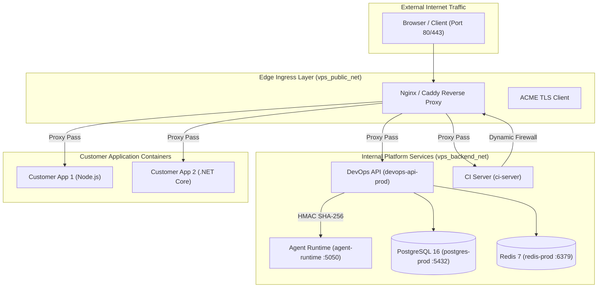

# Host Architecture & Container Network Topology

> **Document ID:** `V2-INFRA-ARCH-001`  
> **Repository:** `vps-infra`  
> **Platform Version:** `v2.3.1`  
> **Status:** Current Authoritative Host Architecture  
> **Audit Date:** 2026-10-20  
> **Related Documents:** [SERVER_INTEGRATION.md](file:///d:/company/products/vps-infra/vps-infra/docs/v2/02-architecture/SERVER_INTEGRATION.md), [HOST_SECURITY.md](file:///d:/company/products/vps-infra/vps-infra/docs/v2/05-security/HOST_SECURITY.md)

---

## 1. Host Architecture Overview

The host architecture is optimized for single-node Linux VPS environments, structuring services into strict isolation boundaries using Docker bridge networks and host volume mounts:

---

## 2. Network Topology & Port Isolation

The host defines two distinct Docker bridge networks in `docker-compose.yml`:

1. **`vps_public_net` (Edge Network):**
   - Attached to the Nginx reverse proxy.
   - Binds to host ports `80` (HTTP) and `443` (HTTPS).
   - Serves incoming public web traffic and terminates TLS certificates.
2. **`vps_backend_net` (Internal Backend Network):**
   - Isolated private bridge network with `internal: true` or unmapped host ports.
   - Connects `devops-api-prod`, `agent-runtime`, `ci-server`, `postgres-prod`, and `redis-prod`.
   - **Zero ports** are published to the host's public network interface. The database and agent runtime cannot be accessed from outside the host.

---

## 3. Persistent Storage & Volume Layout

All stateful data is mounted to dedicated host directories under `/opt/vps-infra/data/`:
- `/opt/vps-infra/data/postgres/`: PostgreSQL database cluster files (`PGDATA`).
- `/opt/vps-infra/data/redis/`: Redis append-only file (`appendonly.aof`).
- `/opt/vps-infra/data/caddy_data/`: ACME account keys and renewed TLS certificates.
- `/opt/vps-infra/apps/`: Application deployment codebases and build artifacts.
- `/opt/vps-infra/backups/`: Physical PostgreSQL `.dump` backup files.
