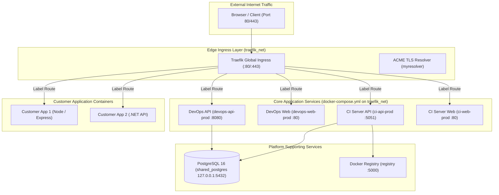

# Host Architecture & Container Network Topology

> **Document ID:** `V2-INFRA-ARCH-001`  
> **Repository:** `vps-infra`  
> **Platform Version:** `v2.3.1`  
> **Status:** Current Authoritative Host Architecture  
> **Audit Date:** 2026-10-20  
> **Related Documents:** [SERVER_INTEGRATION.md](./SERVER_INTEGRATION.md), [HOST_SECURITY.md](../05-security/HOST_SECURITY.md)

---

## 1. Host Architecture Overview

The host architecture is optimized for single-node Linux VPS environments, structuring services into strict isolation boundaries using Docker bridge networks and host volume mounts:

---

## 2. Network Topology & Port Isolation

The host platform organizes network connectivity around the external Docker bridge network:

1. **`traefik_net` (External Bridge Network):**
   - Defined externally in `docker-compose.yml` (`external: true`) and created during platform setup.
   - Attached to the Traefik edge reverse proxy (`platform/network/traefik/docker-compose.yml`).
   - Binds host ports `80` (HTTP) and `443` (HTTPS) to serve public web traffic and automatically provision Let's Encrypt TLS certificates.
   - Core platform services (`devops-api-prod`, `devops-web-prod`, `ci-api-prod`, `ci-web-prod`) communicate internally over `traefik_net` without publishing container ports to external network interfaces.
2. **Loopback Port Isolation (127.0.0.1):**
   - The primary relational database (`shared_postgres`) binds host port 5432 strictly to `127.0.0.1` (`${POSTGRES_PORT_BIND:-127.0.0.1:5432}:5432`).
   - `pgAdmin` binds port 5050 strictly to `127.0.0.1` (`${PGADMIN_PORT_BIND:-127.0.0.1:5050}:80`).
   - Zero database or administration ports are exposed to public interfaces, preventing unauthorized external access.
3. **Agent Runtime Isolation:**
   - The Agent Runtime is deployed as a standalone managed service or process; it is **not** included in the root `vps-infra/docker-compose.yml`.

---

## 3. Persistent Storage & Volume Layout

All stateful data is mounted to dedicated host directories under `/var/www/vps-infra/` (or `${INFRA_BASE_DIR:-/var/www/vps-infra}`):
- `/var/www/vps-infra/docker/volumes/db/postgres/data/`: PostgreSQL database cluster files (`PGDATA`).
- `/var/www/vps-infra/docker/volumes/db/postgres/backups/`: Plain SQL database backup dumps (`devops_prod_*.sql`).
- `/var/www/vps-infra/platform/network/traefik/acme.json`: ACME account keys and automated Let's Encrypt TLS certificates.
- `/var/www/`: Customer application deployment codebases and persistent application storage.
- `/var/www/vps-infra/docker/volumes/license.key`: Local license key verification mount.
