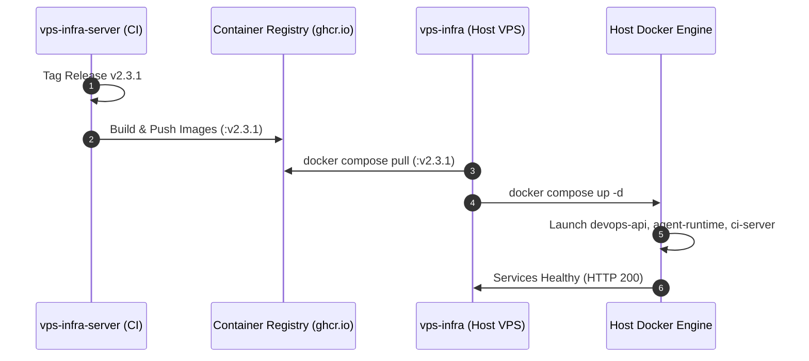

# Control Plane Server Integration

> **Document ID:** `V2-INFRA-ARCH-002`  
> **Repository:** `vps-infra`  
> **Platform Version:** `v2.3.1`  
> **Status:** Current Authoritative Integration Specification  
> **Audit Date:** 2026-10-20  
> **Related Documents:** [HOST_ARCHITECTURE.md](file:///d:/company/products/vps-infra/vps-infra/docs/v2/02-architecture/HOST_ARCHITECTURE.md), [CROSS_REPO_ARCHITECTURE.md](file:///d:/company/products/vps-infra/vps-infra-server/docs/v2/02-architecture/CROSS_REPO_ARCHITECTURE.md)

---

## 1. Integration Model Overview

The `vps-infra` repository acts as the physical execution vehicle for containers built and published by `vps-infra-server`.



---

## 2. Docker Compose Image Pulling & Version Binding

In `vps-infra/docker-compose.yml`, service images are pinned to release versions matching the `VERSION` file:

```yaml
services:
  devops-api-prod:
    image: ghcr.io/tmk-computers/devops-api:v2.3.1
    environment:
      - ConnectionStrings__DefaultConnection=Host=postgres-prod;Port=5432;Database=devopspanel_prod;Username=postgres;Password=${POSTGRES_PASSWORD}
      - Database__AutoMigrateOnStartup=false
    networks:
      - vps_backend_net

  agent-runtime:
    image: ghcr.io/tmk-computers/agent-runtime:v2.3.1
    environment:
      - AgentRuntime__SharedSecret=${AGENT_RUNTIME_SHARED_SECRET}
    networks:
      - vps_backend_net

  ci-server:
    image: ghcr.io/tmk-computers/ci-server:v2.3.1
    networks:
      - vps_backend_net
```

---

## 3. Host Upgrades & Version Checking

The host CLI provides automated version checks against the license server:
```bash
# Check if a new platform version is available
./infra upgrade --check

# Execute an automated rolling upgrade to latest release
./infra upgrade
```
*(Verified in commit `76ce216` feat(upgrade): add --check CLI option to query authoritative release updates).*
