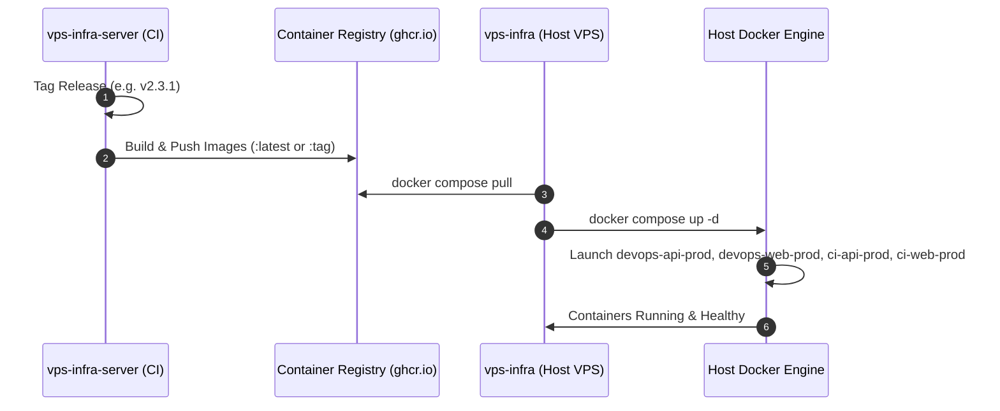

# Control Plane Server Integration

> **Document ID:** `V2-INFRA-ARCH-002`  
> **Repository:** `vps-infra`  
> **Platform Version:** `v2.3.1`  
> **Status:** Current Authoritative Integration Specification  
> **Audit Date:** 2026-10-20  
> **Related Documents:** [HOST_ARCHITECTURE.md](./HOST_ARCHITECTURE.md), [CROSS_REPO_ARCHITECTURE.md](../../../../vps-infra-server/docs/v2/02-architecture/CROSS_REPO_ARCHITECTURE.md)

---

## 1. Integration Model Overview

The `vps-infra` repository acts as the physical execution vehicle for containers built and published by `vps-infra-server`.



---

## 2. Docker Compose Image Pulling & Environment Overrides

In `vps-infra/docker-compose.yml`, service images default to latest pre-built platform images with environment variable overrides:

```yaml
services:
  devops-api-prod:
    image: ${DEVOPS_API_IMAGE:-ghcr.io/tmk-computers/tmk-devops-api:latest}
    environment:
      - ConnectionStrings__DefaultConnection=Host=shared_postgres;Port=5432;Database=${POSTGRES_DB:-devops_prod};Username=${POSTGRES_USER:-postgres};Password=${POSTGRES_PASSWORD}
      - Database__AutoMigrateOnStartup=false
    networks:
      - traefik_net

  devops-web-prod:
    image: ${DEVOPS_WEB_IMAGE:-ghcr.io/tmk-computers/tmk-devops-web:latest}
    networks:
      - traefik_net

  ci-api-prod:
    image: ${CI_API_IMAGE:-ghcr.io/tmk-computers/tmk-ci-api:latest}
    environment:
      - DATABASE_URL=Host=shared_postgres;Port=5432;Database=${POSTGRES_DB:-devops_prod};Username=${POSTGRES_USER:-postgres};Password=${POSTGRES_PASSWORD}
      - PORT=5051
    networks:
      - traefik_net

  ci-web-prod:
    image: ${CI_WEB_IMAGE:-ghcr.io/tmk-computers/tmk-ci-web:latest}
    networks:
      - traefik_net

networks:
  traefik_net:
    name: traefik_net
    external: true
```

---

## 3. Host Upgrades & Version Management

Platform client upgrades are managed via the dedicated standalone script `scripts/upgrade-client.sh`:
```bash
# Check if a newer release tag is available without mutating containers
bash scripts/upgrade-client.sh --check

# Execute client upgrade with python3 / curl / jq diagnostics fallback
bash scripts/upgrade-client.sh
```
*(Verified in commit `41fcb99` fix(upgrade): add python3 fallback and explicit diagnostics when jq or curl fails, and commit `7bac7f7` managing local runtime version dynamically).*
