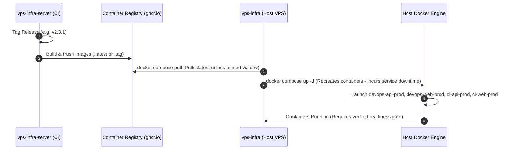

# Control Plane Server Integration

> **Maintained by:** repository documentation owner (role; individual approval pending). **Reviewed source parents:** server c458c831711ba2e82a382719f76c98551d7d5a70; infra44a5d6a32bf59f50e7c13b663dbd22bac31eb53d. **Last verified:**2026-10-20. **Review trigger:** any source/DTO/config/schema/package/CLI/deployment change. [Maintenance and checks](../../../../vps-infra-server/docs/v2/08-quality/MAINTENANCE.md).

> **Document ID:** `V2-INFRA-ARCH-002`  
> **Repository:** `vps-infra`  
> **Platform Version:** `v2.3.1`  
> **Status:** Source-aligned reference candidate; independent approval pending
> **Audit Date:** 2026-10-20  
> **Related Documents:** [HOST_ARCHITECTURE.md](./HOST_ARCHITECTURE.md), [CROSS_REPO_ARCHITECTURE.md](../../../../vps-infra-server/docs/v2/02-architecture/CROSS_REPO_ARCHITECTURE.md)

---

## 1. Integration Model Overview

The `vps-infra` repository acts as the physical execution vehicle for containers built and published by `vps-infra-server`.



> [!WARNING]
> **No Implicit Zero-Downtime:** `docker compose up -d` stops and recreates running containers, incurring service interruption during container startup and healthcheck validation. Zero-downtime rolling updates or blue-green staging requires separate proxy routing and is currently **PROPOSED (Target State)**, not implemented in base compose.

---

## 2. Docker Compose Image Pulling & Environment Overrides

In `vps-infra/docker-compose.yml`, service images default to latest pre-built platform images with environment variable overrides. Git release tags do **not** automatically bind to container image tags unless explicitly supplied through environment variables:

Image interpolation is read directly from root docker-compose.yml: DEVOPS_API_IMAGE, DEVOPS_WEB_IMAGE, CI_API_IMAGE, CI_WEB_IMAGE default to ghcr.io/tmk-computers/tmk-devops-api:latest, tmk-devops-web:latest, tmk-ci-api:latest and tmk-ci-web:latest respectively (same registry prefix). Profiles are all/devops/ci. CI DATABASE_URL uses the actual PostgreSQL URI interpolation, not an ADO.NET semicolon connection string. API uses ConnectionStrings__DefaultConnection. Database__AutoMigrateOnStartup=false does not bypass Seeder DDL. See the exact source before resolving environment; do not print secrets into audit logs.

---

## 3. Host Upgrades & Dynamic Version Management

Platform client upgrades are managed via the dedicated standalone script `scripts/upgrade-client.sh`.

### Dynamic Runtime `VERSION` Contract (Commit `7bac7f7`)

Historically, a static `VERSION` file was tracked in Git, creating merge conflicts and false-freshness assumptions across host pulls. Under commit `7bac7f7`:
1. **Git-Ignored Runtime File:** `VERSION` is removed from Git tracking and added to `.gitignore`, preserving the local installed client version across Git operations.
2. **Setup Initialization:** `setup.sh` records the initial installed release tag or commit hash into `VERSION` upon provisioning.
3. **Full upgrade path:** scripts/upgrade-client.sh fetches origin main, resets tracked files to origin/main and runs setup.sh. After setup returns success it writes VERSION from local git describe --tags --abbrev=0, falling back to the short commit. This is not cryptographic tag verification or independent health qualification; check mode is separate.
4. **Release Automation:** `scripts/release.sh` reads release version numbers directly from Git tags rather than relying on a static committed file.

```bash
# Check-only mode calls the license version-check API; no Git fetch/reset/setup path is entered
# Future operator check only: bash scripts/upgrade-client.sh --check

# Execute client upgrade with python3 / curl / jq diagnostics fallback
# Mutating future operator action: bash scripts/upgrade-client.sh
```
Check-only source contract: --check and -c read the installed VERSION (fallback v2.1 if unreadable), call ${LICENSE_SERVER_URL:-https://license.tmkcomputers.in}/api/v1/license/version-check with currentVersion, capture curl errors in a temporary curl-error file created by mktemp, read and remove that temporary file, then parse/report or exit with an error. This branch exits before the full-upgrade lock/log/configuration-backup/Git fetch/reset/setup behavior. It is an HTTP release query, not a remote Git tag query and not an absolutely filesystem-free action. No check or live upgrade was executed for this documentation correction.

Historical source witnesses:41fcb99 introduced parsing diagnostics/fallback;7bac7f7 introduced ignored runtime VERSION management. Current behavior is verified against scripts/upgrade-client.sh on the reviewed infra baseline.

Upgrade execution includes reset --hard origin/main; local changes can be lost. VERSION success is not proof of image health, rollback or schema qualification. Observed remote-main-only cfb01ab source drift must be separately qualified; see SOURCE_BASELINE.
