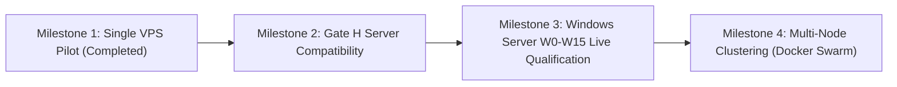

# Infrastructure Implementation Roadmap

> **Document ID:** `V2-INFRA-ROAD-001`  
> **Repository:** `vps-infra`  
> **Platform Version:** `v2.3.1`  
> **Status:** Current Authoritative Infrastructure Roadmap  
> **Audit Date:** 2026-10-20  
> **Related Documents:** [INDEX.md](file:///d:/company/products/vps-infra/vps-infra/docs/v2/INDEX.md), [PILOT_RELEASE_GATES.md](file:///d:/company/products/vps-infra/vps-infra/docs/v2/08-quality/PILOT_RELEASE_GATES.md)

---

## 1. Milestones & Delivery Progression

### Milestone 1: Single VPS Pilot Release Gate (COMPLETED)
- Verified automated setup on Ubuntu 22.04 / 24.04 (`setup.sh`).
- Verified database backup, restore, and in-flight rollback drills (`docs/audits/`).
- Achieved **CONDITIONAL PASS** for controlled customer pilots.

### Milestone 2: Server Compatibility & Gate H Remediation Alignment (CURRENT)
- Align host compose configuration with server Gate H corrections.
- Ensure `Database__AutoMigrateOnStartup=false` is strictly observed.
- Integrate updated container images once server Gate H passes independent re-audit.

### Milestone 3: Windows Server Full Qualification (Phases W0–W15)
- Deploy disposable Windows Server 2022/2025 VMs via PowerShell test harness (`scripts/test-windows-w0.ps1`).
- Verify IIS ARR reverse proxy automation and Let's Encrypt TLS renewal on Windows.
- Pass formal Windows Qualification Gate A.

### Milestone 4: Multi-Node Clustering (Future Phase)
- Implement Docker Swarm or lightweight Kubernetes (k3s) orchestration for multi-VPS cluster deployments.
