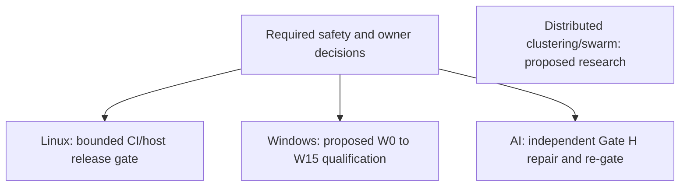

# Infrastructure Implementation Roadmap

> **Maintained by:** repository documentation owner (role; individual approval pending). **Reviewed source parents:** server c458c831711ba2e82a382719f76c98551d7d5a70; infra44a5d6a32bf59f50e7c13b663dbd22bac31eb53d. **Last verified:**2026-10-20. **Review trigger:** any source/DTO/config/schema/package/CLI/deployment change. [Maintenance and checks](../../../../vps-infra-server/docs/v2/08-quality/MAINTENANCE.md).

> **Document ID:** `V2-INFRA-ROAD-001`  
> **Repository:** `vps-infra`  
> **Platform Version:** `v2.3.1`  
> **Status:** Source-aligned reference candidate; independent approval pending
> **Audit Date:** 2026-10-20  
> **Related Documents:** [INDEX.md](../INDEX.md), [PILOT_RELEASE_GATES.md](../08-quality/PILOT_RELEASE_GATES.md)

---

## Independent release tracks

Historical phases are not renumbered. An AI swarm is not a prerequisite for separately scoped Linux or Windows work; each release still depends on the safety checks relevant to its actual stack. Current Linux OMR workload is HOLD, Windows W0 is proposed/re-gated2026-10-06 and the named Server2025 harness only preserves baseline. It provisions no VM or installer/rollback qualification. Source application GH01 is not made safe by an env switch.

Future clustering and autonomous swarms need separate owner ADR, networking/trust/recovery/capacity evidence, failure-injection and operational qualification. No phase is complete merely because a plan or preservation script exists.
