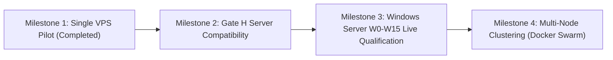

# Infrastructure Implementation Roadmap

> **Document ID:** `V2-INFRA-ROAD-001`  
> **Repository:** `vps-infra`  
> **Platform Version:** `v2.3.1`  
> **Status:** Current Authoritative Infrastructure Roadmap  
> **Audit Date:** 2026-10-20  
> **Related Documents:** [INDEX.md](../INDEX.md), [PILOT_RELEASE_GATES.md](../08-quality/PILOT_RELEASE_GATES.md)

---

## 1. Milestones & Delivery Progression

### Milestone 1: Historical Staging Pilot Release Gate (HISTORICAL — CONDITIONAL HOLD)
- Evaluated automated setup on Ubuntu 24.04 (`setup.sh`) under representative staging workloads.
- Verified database backup, restore, and worker in-flight rollback drills (`docs/audits/`).
- Formal verdict: **CONDITIONAL HOLD / Production NO-GO** pending off-host backup replication and origin strict TLS configuration.

### Milestone 2: Server Compatibility & Gate H Remediation Alignment (CURRENT)
- Align host compose configuration with server Gate H corrections.
- Ensure `Database__AutoMigrateOnStartup=false` is strictly observed.
- Integrate updated container images once server Gate H passes independent re-audit.

### Milestone 3: Windows Server Qualification Track (Phases W0–W15 — PROPOSED ADR)
- Phase W0 ADR is PROPOSED & RE-GATED FOR STAKEHOLDER SIGN-OFF (checked 2026-10-06).
- Evaluate disposable Windows Server 2025 VMs via PowerShell test harness (`scripts/windows/Invoke-W0VmPreservationCheck.ps1`).
- Address IIS ARR syntax errors (`DEF-28`), SCM service dispatch (`DEF-29`), and HTTP.sys loopback bindings (`DEF-30`).
- Pass formal Windows Qualification Gate before permitting customer workloads.

### Milestone 4: Multi-Node Clustering (Future Phase)
- Implement Docker Swarm or lightweight Kubernetes (k3s) orchestration for multi-VPS cluster deployments.
