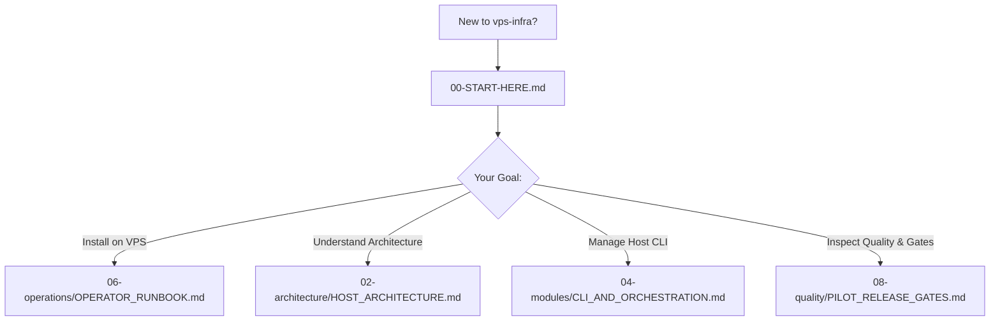

# VPS Infrastructure Documentation V2 — Navigation Hub

> **Maintained by:** repository documentation owner (role; individual approval pending). **Reviewed source parents:** server d7e8df99cb2b099eb8b6290e524af4d01a6c4a4d; infra b84f9d5de8da991cb603d696b94f829f5361e64a. **Last verified:**2026-10-21. **Review trigger:** any source/DTO/config/schema/package/CLI/deployment change. [Maintenance and checks](../../../vps-infra-server/docs/v2/08-quality/MAINTENANCE.md).

> **Project:** Unified VPS-Infra Platform  
> **Repository:** `vps-infra`  
> **Platform Version:** `v2.3.1`  
> **Inspected merged-main baseline:** `b84f9d5de8da991cb603d696b94f829f5361e64a` (2026-10-21); see [source baseline](./08-quality/SOURCE_BASELINE.md).
> **Companion Repository:** [`vps-infra-server` (application source, built for customer installations)](../../../vps-infra-server/docs/v2/INDEX.md)

> **Customer-hosted scope (ARCH-SELFHOST-01):** Repository names describe source/distribution responsibilities, not hosting locations. Each customer operates its local Control Plane, CI and operational state; TMK centrally operates the separate License Server. Full supported runtime packaging remains partial. [Authoritative architecture](../../../vps-infra-server/docs/v2/02-architecture/SELF_HOSTED_PLATFORM.md).

---

## 1. Welcome to VPS Infrastructure Documentation V2

The **`vps-infra`** repository provides the client-side host infrastructure, automated server installer (`setup.sh`), Docker Compose platform definitions, host orchestration CLI (`infra`), and customer application stack templates.

---

## 2. Master V2 Navigation Structure

### `00` Orientation
- **[00-START-HERE.md](./00-START-HERE.md)**: Beginner guide to VPS infrastructure provisioning, CLI basics, and directory layouts.

### `01` Product Specifications
- **[01-product/INFRASTRUCTURE_OVERVIEW.md](./01-product/INFRASTRUCTURE_OVERVIEW.md)**: Product purpose, target hardware environments, and single-VPS hosting feasibility.

### `02` Architecture
- **[02-architecture/HOST_ARCHITECTURE.md](02-architecture/HOST_ARCHITECTURE.md)**: Directory hierarchy (`/var/www/vps-infra`), Traefik external bridge network (`traefik_net`), automated ACME TLS, and volume mounts.
- **[02-architecture/SERVER_INTEGRATION.md](./02-architecture/SERVER_INTEGRATION.md)**: How `vps-infra` pulls, configures, and deploys containers built by `vps-infra-server`.

### `03` Development
- **[03-development/LOCAL_SETUP.md](./03-development/LOCAL_SETUP.md)**: Local testing workflows, shell linting (ShellCheck), and script test runners.

### `04` Modules
- **[04-modules/CLI_AND_ORCHESTRATION.md](./04-modules/CLI_AND_ORCHESTRATION.md)**: The `infra` and `infra.ps1` CLI scripts, lifecycle verbs, and environment flags.
- **[04-modules/STACK_TEMPLATES.md](./04-modules/STACK_TEMPLATES.md)**: Pre-configured stack templates for Node.js, .NET Core, PHP, Python, and Static Web.

### `05` Security
- **[05-security/HOST_SECURITY.md](./05-security/HOST_SECURITY.md)**: Host firewall (UFW), SSH hardening, automated Let's Encrypt TLS, and license activation.

### `06` Operations
- **[06-operations/OPERATOR_RUNBOOK.md](./06-operations/OPERATOR_RUNBOOK.md)**: Step-by-step installation, routine operations, container upgrades, and log rotation.
- **[06-operations/DISASTER_RECOVERY.md](./06-operations/DISASTER_RECOVERY.md)**: Database backups, volume restore drills, and automated deployment rollback.

### `07` Roadmap
- **[07-roadmap/INFRA_ROADMAP.md](./07-roadmap/INFRA_ROADMAP.md)**: Infrastructure milestones, single-VPS pilot, and Windows Server qualification.

### `08` Quality & Truth Baseline
- **[08-quality/SOURCE_BASELINE.md](./08-quality/SOURCE_BASELINE.md)**: Exact commit SHA, working tree status, and verified script baseline.
- **[08-quality/KNOWN_ISSUES.md](./08-quality/KNOWN_ISSUES.md)**: Infrastructure-specific defects and compose configuration quirks.
- **[08-quality/PILOT_RELEASE_GATES.md](./08-quality/PILOT_RELEASE_GATES.md)**: Single-VPS go-live feasibility and pilot release gate reports.

### `09` Decisions
- **[09-decisions/ADR_INDEX.md](./09-decisions/ADR_INDEX.md)**: Host architecture decision records.

### `10` Reference
- **[10-reference/CLI_REFERENCE.md](./10-reference/CLI_REFERENCE.md)**: Complete CLI command, flag, and environment variable reference.

Current implementation candidate: [complete28-finding remediation and remaining acceptance boundaries](../../../vps-infra-server/docs/v2/08-quality/CODEX_COMPLETE_REMEDIATION/README.md). Independent reference approval is pending.

[Final two blockers: source census and owner/CI decisions](../../../vps-infra-server/docs/v2/08-quality/FINAL_BLOCKER_CLOSURE/README.md). Evidence and approvals remain pending; no reference approval is implied.
